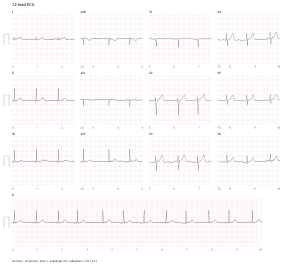
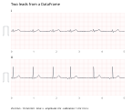
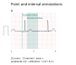

# ECG plot

SVG-first ECG charts for research, with pandas/NumPy input, physical scales,
annotations, and optional Matplotlib support. Python 3.10 or newer.



*A 10-second recording shown in sequential lead panels, with a full-length II
rhythm strip. [Open the SVG](docs/images/12lead.svg) · [PNG fallback](docs/images/12lead.png).*

## Why SVG first?

ECG plot began with a practical problem: plotting ECGs with Matplotlib was slow,
and producing sufficiently detailed PNGs was difficult. Its goal is to make
clear, publication-ready ECG charts easy to generate.

The SVG-first design provides:

* **Direct vector output** without constructing Matplotlib figures or initializing
  its backend.
* **Sharp waveforms and grids** that remain clear when zoomed, with PNG export
  at the resolution you choose.
* **Explicit physical scales** for paper speed, gain and calibration, calculated
  in millimetres.

Matplotlib remains available for researchers who want editable figures and
integration with their existing Python workflows. Both outputs use the same
ECG layout and drawing geometry.

## Installation

```sh
pip install 'ecg_plot[pandas,export]'
# Optional: editable Matplotlib figures and historical APIs
pip install 'ecg_plot[matplotlib]'
```

For NumPy input and SVG-only output, `pip install ecg_plot` is sufficient.
The base package needs only NumPy. SVG generation does not import Matplotlib,
pandas, Cairo or Pillow. The optional `pandas` extra enables DataFrame/Series
workflows, `export` supplies CairoSVG/Pillow for PNG, PDF and JPEG, and
`matplotlib` enables editable figures and historical APIs. CairoSVG also needs
a working system Cairo library; if it is unavailable, SVG export still works.

## Quick start with pandas

Each DataFrame column is a lead; each row is a sample. Column names become lead
labels automatically, so no transpose or separate name list is needed.

The examples below use the bundled [ECG CSV](examples/ecg.csv), a 500 Hz copy of
this repository's `example_ecg.mat`. Run them from the repository root, or
download the CSV and adjust its path.

```python
import pandas as pd
import ecg_plot

df = pd.read_csv('examples/ecg.csv')
chart = ecg_plot.plot(
    df[['I', 'II']],
    sample_rate=500,
    units='mV',
    layout='stacked',
    window=(0, 5),
    title='Two leads from a DataFrame',
)
chart  # Displays inline in a notebook
```



[Open the SVG](docs/images/pandas-stacked.svg) · [PNG fallback](docs/images/pandas-stacked.png).

Use pandas to select and reorder leads: `df[['II', 'I', 'V1']]`. A Series such
as `df['II']` produces a single-lead chart, using the Series name as its label.
Select signal columns only, excluding metadata or a numeric timestamp column.

### One chart, multiple outputs

```python
chart.save('ecg.svg')
chart.save('ecg.png', dpi=300)
chart.save('ecg.pdf')
```

A notebook displays `chart` as inline SVG. `chart.show()` opens an SVG in the
browser and returns its temporary path (the caller may delete it after viewing).
Saving does not close the chart. File paths may be strings or `pathlib.Path`.
Output directories must already exist. PNG stores DPI metadata as well as the
requested pixel dimensions. PDF and SVG retain vector paths.

### Time indices

DatetimeIndex and TimedeltaIndex supply actual relative seconds, beginning at the
first timestamp. Gaps/nonuniform intervals are preserved. Timestamps must be
strictly increasing and nonmissing. If a sample rate is also supplied, it must
agree with the index. To intentionally ignore timestamps, reset the index first.
Ordinary numeric indices are sample labels, not inferred seconds. Without a time
index or explicit sample rate, **500 Hz is retained for compatibility**; explicitly
supply the actual rate in research code. The viewport extends one sample interval
beyond the final sample (median interval for an irregular time index).

## NumPy support

NumPy arrays are also supported. A one-dimensional array is one lead. A
two-dimensional array defaults to **leads × samples**, retaining the original
array convention. Use `lead_axis=1` for **samples × leads**, such as the array
returned by `DataFrame.to_numpy()`:

```python
signals = df[['I', 'II']].to_numpy()  # samples × leads
chart = ecg_plot.plot(
    signals,
    lead_axis=1,
    lead_names=['I', 'II'],
    sample_rate=500,
    units='mV',
    layout='stacked',
    window=(0, 5),
)
```

If your array is already **leads × samples**, omit `lead_axis`. Unnamed arrays
get `CH1`, `CH2`, etc.; provide `lead_names` when lead identities are known.
The library does not infer anatomical leads from channel count.

### Units and missing data

* `units='mV'` is the default. `uV`, `µV`, `μV`, `V`, or a mapping of lead names
  to units are supported. Internally values are converted to mV. ADC values must
  be converted using the recording's calibration before plotting.
* NaNs create gaps. No filtering, normalization, interpolation, automatic
  baseline correction, or decimation is performed in normal exports. Infinite
  values are rejected.
* Input is copied, so later changes to an array or DataFrame do not change an
  existing chart.

## Layout and physical scale

`plot()` returns `ECGChart`. Its main options are:

| Option | Meaning |
| --- | --- |
| `layout='columns'` | Column-major arrangement; `columns=2` by default, as in the old general plot |
| `layout='row-major'` | Historical `plot_12` order, alternating columns by row |
| `layout='limb-chest'` | Six rows: limb leads on the left, chest leads on the right; matches by name |
| `layout='stacked'` | All leads vertically aligned at the same original times |
| `layout='12lead'` | Three rows/four columns in I/II/III, aVR/aVL/aVF, V1–V3, V4–V6 groups |
| `layout='rhythm'` | Wrap each selected lead at `seconds_per_row=10` |
| `window=(start, end)` | Half-open interval in original-record seconds |
| `speed=25` | Horizontal scale in mm/s |
| `gain=10` | Vertical scale in mm/mV |
| `time_mode='simultaneous'` | Each column uses the same window |
| `time_mode='sequential'` | Divide the selected window equally among columns (columns/12lead layouts) |
| `rhythm_lead='II'` | Add a full-window strip below a 12lead layout |
| `amplitude_range=(low, high)` | Explicit mV display bounds without normalization; clipped signals are visibly flagged |
| `row_height=None` | Automatic shared row height; explicit height is in mm and cannot clip the signal |

The 12lead preset requires all twelve standard lead names. It never derives,
reorders or inverts signal values implicitly. Here is a compact report:

```python
chart = ecg_plot.plot(df, sample_rate=500, units='mV', title='12-lead ECG',
                      layout='12lead', time_mode='sequential',
                      rhythm_lead='II', window=(0, 10),
                      speed=25, gain=10)
```

This produces the report shown at the top of this README.

Geometry uses exact millimetres: a one-second interval is `speed` mm, a 1 mV
change is `gain` mm. Minor/major grids are spaced 1/5 mm. Margins are added outside
waveform areas, not subtracted from them. Row heights grow to accommodate the
selected signal range; every lead retains the same gain. Panel labels identify
original time intervals. A footer records speed, gain and amplitude units.

The chart's `width_mm` and `height_mm` report its native physical page size.
To fit a publication column while preserving aspect ratio, explicitly resize on
export:

```python
chart.save('publication.svg', width_mm=180)
chart.save('publication.png', width_mm=180, dpi=300)
```

This scales the entire chart uniformly, including its grid, and updates the
footer to report the **effective** paper speed and gain. Grid squares are then
scaled too; they are 1/5 mm only at native size. It does not change the chart or
future exports. `chart.to_matplotlib(width_mm=180)` uses the same fit behavior.
If maintaining native speed/gain is required, shorten the time window or change
the layout instead. Resizing externally or using a printer's “fit to page”
changes physical scale without updating labels.

## Styling

```python
style = ecg_plot.Style(grid=False, line_color='black', line_width=0.2,
                       lead_names=True, axes=True, font_size=3,
                       time_tick=1, calibration=True)
chart = ecg_plot.plot(df, sample_rate=500, style=style)
```

`line_width` and `font_size` are in mm. `style='bw'` is a black/white preset.
`axes` controls the per-panel time labels. `time_tick` is the requested seconds
between labels, independent of the grid. Labels are horizontal; spacing grows
when needed to avoid crowding. Calibration pulses represent 1 mV and 0.2 s.
Style affects all layouts consistently. The default uses a dark trace with pale
minor grid lines, stronger major lines, and horizontal lead names.

## Points and intervals

```python
chart = ecg_plot.plot(
    df['II'], sample_rate=500, units='mV', window=(2, 4),
    title='Point and interval annotations',
)
chart.add_annotations([
    {'sample': 1250, 'lead': 'II', 'label': 'Example event'},
    {'time': 2.7, 'end_time': 3.2, 'label': 'Review window'},
])
```



*Illustrative markers, not clinical annotations.
[Open the SVG](docs/images/annotations.svg) · [PNG fallback](docs/images/annotations.png).*

Annotations accept a list of mappings or a DataFrame. Use `time`/`end_time` in
original-record seconds, or `sample`/`end_sample` as original-record sample
indices. Do not mix coordinate systems within a row. Omitting `lead` marks all
panels; `label` describes the event and optional `source` identifies its origin.
The method's `label` overrides source names. Intervals are clipped to the selected
window; out-of-window points are not displayed. No detection or measurement
algorithm is run. Interval ends are exclusive. Samples must index existing data.
Multiple annotation sets share up to `Style.annotation_lanes` (default 3) text
lanes. A conservative width estimate avoids overlapping labels; when lanes are
full, `+N labels` reports suppressed text while all event markers remain. This
is a bounded static layout, not an interactive annotation editor. Exact glyph
widths may vary by font and backend.

## Matplotlib adapter

```python
fig, ax = chart.to_matplotlib()
fig.savefig('editable.pdf')
```

This creates an independent editable figure from the same geometry, not a raster
copy of SVG. The single Axes uses **millimetres**, with y increasing downward,
for both waves and annotations. It is suitable for figure composition and artist
editing; it is not a lead-specific seconds/mV Axes. Edits to it do not mutate the
original chart. Save the edited version with `fig.savefig()`.

## Migration from 0.2.x

* `plot()` now returns an `ECGChart`. The default remains a two-column,
  column-major arrangement, but new geometry uses exact physical scales,
  automatic row heights, and generic labels for unnamed arrays. Output is not
  pixel-identical to 0.2.x. Supply lead names for anatomical labels.
* `plot_1()` and `plot_12()` preserve their argument signatures and return a
  managed Matplotlib Figure, but now translate into the **same chart core** as
  `plot()`. There is no separate legacy drawing engine. The new styles, accurate
  scale, horizontal labels and calibration pulses apply to all entry points.
  `plot_12()` keeps its historical defaults of 50 mm/s and 20 mm/mV and row-major
  order; its geometry is now exact. Optional `layout='limb-chest'` groups leads,
  and `width_mm=280` explicitly fits the output for publication/preview.
  `plot_1()` fits uniformly inside its historical width/height bounds (inches)
  instead of stretching the signal. Reported scale reflects that fit.
  Legacy line widths remain in points; `Style.line_width` is in mm.
* Positional arguments after `data`, or old-only keywords (`lead_index`,
  `lead_order`, `show_grid`, `show_lead_name`, `show_separate_line`), select the
  Matplotlib compatibility adapter and emit a DeprecationWarning. Do not mix them with
  new chart options. Replace these with named columns, pandas selection, and
  `Style` when migrating. The legacy `row_height` maps to its historical
  symmetric amplitude range; the new chart uses mm. `show_separate_line` is
  obsolete because panels have separate viewports. The returned Figure now
  contains one scene Axes in mm, not one seconds/mV Axes per lead; code that
  edits individual old subplots needs migration.
* Existing `plot(...); save_as_png(...)` and `show()` calls still work. Helpers
  retain the latest ECG object rather than an unrelated current pyplot figure.
  Saves no longer close figures. For multiple charts, prefer `chart.save()` or
  `fig.savefig()`.
* The modern interface uses `gain` rather than `voltage`. Historical `plot_12`
  continues accepting `voltage`.
* PDF export is now `chart.save('file.pdf')` or `save_as_pdf('file', directory)`.

## Shared drawing architecture

```text
pandas / NumPy → normalized record → layout and scene in mm
                                         ├─ SVG renderer → SVG / PNG / PDF
                                         └─ Matplotlib renderer → Figure
Historical signatures → argument adapter ─┘
```

`compat.py` only maps arguments/units and registers managed figures. `chart.py`
creates all ECG geometry once. `renderers.py` only paints generic paths, text,
rectangles and clip regions; it does not know ECG lead order or sampling rates.
The compatibility import path `ecg_plot.ecg_plot` is retained as a re-export.

## Long records and display bounds

Use `window` to inspect sections. To stop artifacts from expanding every row,
use `amplitude_range=(-2, 2)`. This changes only the viewport, retains gain and
original values, and adds `OUT OF RANGE` to affected panels. It cannot be combined
with `row_height`.

For a lightweight explicit preview:

```python
svg = chart.to_svg(preview_points=2000)
fig, ax = chart.to_matplotlib(preview_points=2000)
```

The limit applies per continuous finite run. Each chronological bucket retains
its endpoints and both extrema; NaN gaps remain gaps. Such outputs are marked
`PREVIEW`. This is a visualization shortcut, not signal resampling. `save()` and
normal SVG output always keep all points. Extremely fragmented data may exceed
the requested total because separate gaps are never bridged.

## Regenerating the examples

The figures above are generated from the bundled CSV using the same plotting
calls shown here. The README embeds SVG directly for crisp scaling; PNG copies
are provided as fallbacks. To rebuild both formats from a checkout:

```sh
pip install -e '.[pandas,export]'
python -m examples.render_readme
```

The script writes to `docs/images/`. It does not need SciPy or Matplotlib.

## Development

```sh
pip install -e '.[test]'
python -m pytest
python -m build
```

Tests cover sample-count boundaries, pandas orientation/time/units, layout,
annotation alignment, physical geometry, exports, optional-dependency isolation,
and historical entry points. `ecg_plot_test.py` is an optional SciPy-based example,
not an automated test and does not run on import. CI is configured for Python
3.10/3.13 on Linux, Windows and macOS; Cairo-backed export tests run on Linux.
A local test pass does not imply the remote CI matrix has already run.

License: MIT (see `LICENCE`).
